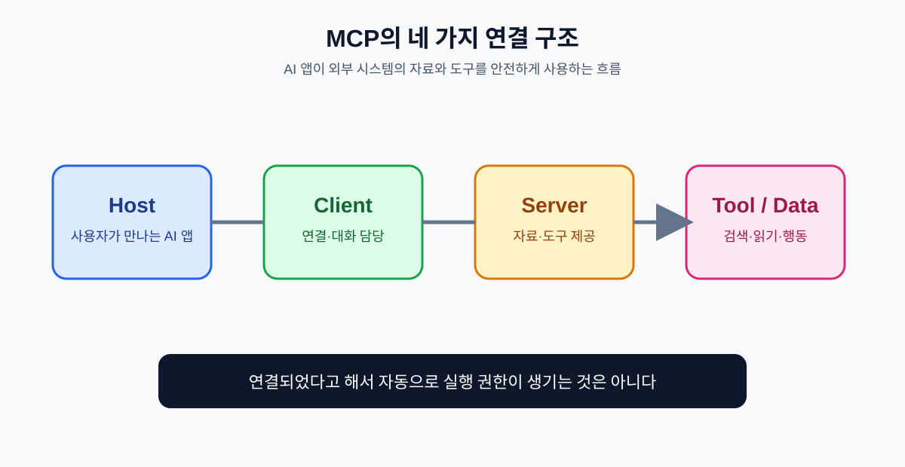

# 01. MCP란 무엇인가

## 먼저 비유로 이해하기

AI를 직원이라고 생각해 봅시다. 모델은 글을 읽고 판단하는 능력이 있지만, 회사 드라이브·캘린더·주문 시스템에 들어갈 열쇠는 기본으로 가지고 있지 않습니다. MCP는 직원과 사내 시스템 사이에 놓이는 **공통 출입구와 사용 규칙**입니다.

| 비유 | MCP에서의 이름 | 역할 |
| --- | --- | --- |
| 직원이 보는 업무 화면 | Host | 사용자가 AI를 만나는 앱 |
| 출입구를 관리하는 연결선 | Client | Host와 서버 사이의 연결 담당 |
| 부서별 창구 | Server | 특정 데이터·도구를 제공 |
| 창구에서 할 수 있는 업무 | Tool | 검색·생성·변경 같은 실행 기능 |
| 열람 가능한 자료실 | Resource | 문서·파일·구조화된 데이터 |
| 미리 만든 업무 양식 | Prompt | 반복 작업을 시작하는 안내 |

MCP 서버가 있다고 해서 AI가 모든 자료를 읽거나 모든 버튼을 누를 수 있는 것은 아닙니다. 어떤 도구를 노출할지, 사용자의 승인을 언제 받을지, 인증을 어떻게 할지는 별도로 정해야 합니다.

## API와 MCP의 관계

MCP가 API를 없애는 것은 아닙니다. 기존 API를 AI가 사용할 수 있도록 설명·발견·권한·결과 형식을 표준화하는 층에 가깝습니다.

| 구분 | 일반 API | MCP |
| --- | --- | --- |
| 주된 호출자 | 사람이 만든 프로그램 | AI 애플리케이션과 에이전트 |
| 연결 방식 | 서비스마다 다른 문서와 형식 | 공통 프로토콜과 기능 설명 |
| 선택 주체 | 코드가 미리 결정 | 모델이 후보 중 선택할 수 있음 |
| 안전장치 | 애플리케이션이 직접 구현 | 사용자 동의·권한·정책과 함께 설계 |
| 대체 관계 | 기반 시스템 | 기반 API를 AI에 노출하는 연결층 |

## MCP가 해결하려는 반복 문제

1. AI 제품마다 같은 서비스 연동을 다시 개발하는 문제
2. 도구의 입력과 출력 형식이 제각각인 문제
3. 어떤 데이터가 모델에 전달됐는지 추적하기 어려운 문제
4. 읽기와 쓰기 권한을 구분하지 못하는 문제
5. 로컬 도구와 원격 서비스를 연결하는 방식이 달라지는 문제

## 기억해야 할 경계

MCP는 “AI에게 권한을 주는 마법”이 아니라 **권한을 설계하고 전달하는 표준화된 통로**입니다. 연결 전에 다음을 문서로 적습니다.

| 결정 | 예시 |
| --- | --- |
| 읽을 수 있는 범위 | 이번 프로젝트의 공개 문서만 |
| 실행할 수 있는 행동 | 초안 저장까지, 외부 발송은 금지 |
| 승인 지점 | 고객 메시지 발송 전 사람 확인 |
| 기록할 내용 | 사용자, 도구, 입력 요약, 결과, 시각 |
| 중단 방법 | 연결 해제, 토큰 폐기, 작업 취소 |

## 장 요약

- MCP는 AI와 외부 데이터·도구를 연결하는 공통 규칙이다.
- Host·Client·Server를 구분하면 문제가 생겼을 때 책임 위치를 찾기 쉽다.
- Tool은 행동을, Resource는 자료를, Prompt는 반복 작업의 시작점을 제공한다.
- 연결과 권한 부여는 별개의 결정이다.

## 출처

- [MCP 공식 개요](https://modelcontextprotocol.io/)
- [MCP 서버 구성요소](https://modelcontextprotocol.io/specification/draft/server/index)
