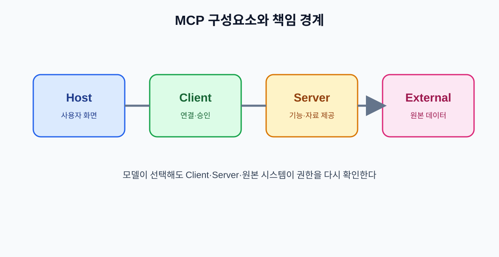

# 03. MCP의 네 가지 구성요소

MCP를 처음 보면 Host, Client, Server라는 단어가 모두 비슷하게 느껴집니다. 하지만 이 셋을 구분하지 않으면 문제가 생겼을 때 “AI가 잘못했는지, 연결이 잘못됐는지, 서버 권한이 잘못됐는지”를 찾기 어렵습니다.

## 3.1 Host: 사용자가 보는 앱

Host는 사용자가 AI와 대화하거나 작업을 요청하는 애플리케이션입니다. 데스크톱 앱, 웹 서비스, IDE, 사내 업무 화면 등이 될 수 있습니다. Host는 사용자의 로그인 상태와 동의 화면을 관리하고, 여러 MCP 연결을 한곳에서 보여 줄 수 있습니다.

Host가 반드시 직접 외부 API를 호출하는 것은 아닙니다. 보통 Host 안에 MCP Client가 하나 이상 만들어지고, Client가 MCP Server와 통신합니다.

## 3.2 Client: 연결을 담당하는 통역사

Client는 Host와 Server 사이에서 프로토콜 메시지를 주고받습니다. 서버가 제공하는 도구 목록을 읽고, 사용자가 허용한 범위 안에서 모델의 도구 호출을 전달합니다.

| Client가 하는 일 | 쉬운 설명 |
| --- | --- |
| 서버 연결 | 어느 서버에 연결할지 관리 |
| 기능 발견 | tools·resources·prompts 목록 확인 |
| 메시지 전달 | 모델의 요청을 서버 형식으로 변환 |
| 결과 전달 | 서버 결과를 Host와 모델에 보여 줌 |
| 권한 확인 | 사용자의 승인과 연결 상태 관리 |

## 3.3 Server: 자료와 행동을 제공하는 창구

MCP Server는 특정 시스템의 기능을 MCP 형식으로 노출합니다. 회사 문서 검색 서버는 Resource나 읽기 도구를 제공할 수 있고, 캘린더 서버는 일정 조회·초안 생성 도구를 제공할 수 있습니다.

서버는 “AI에게 무엇을 시킬지”보다 “어떤 기능을 어떤 입력으로 제공할지”를 명확히 정의해야 합니다. 이름이 모호하고 입력 범위가 넓은 도구는 모델과 사람 모두에게 위험합니다.

## 3.4 외부 시스템: 실제 데이터와 상태가 있는 곳

외부 시스템은 파일 저장소, 데이터베이스, SaaS, 사내 API처럼 실제 상태를 보관합니다. MCP Server는 이 시스템의 권한과 오류를 숨기지 말고 적절한 결과로 전달해야 합니다.

## 3.5 한 요청이 흐르는 순서

1. 사용자가 Host에서 “지난달 환불 요청을 찾아 요약해 줘”라고 말합니다.
2. Host의 모델이 필요한 도구를 선택합니다.
3. Client가 도구 이름과 입력을 검증합니다.
4. 사용자 승인이 필요하면 Host가 승인 화면을 보여 줍니다.
5. MCP Server가 외부 시스템에서 데이터를 조회합니다.
6. Server가 결과와 오류 상태를 Client에 돌려줍니다.
7. Host가 결과를 사용자에게 보여 주고, 모델이 요약합니다.

이 흐름에서 모델은 외부 시스템의 비밀번호를 직접 다루지 않습니다. 또한 모델의 도구 선택은 실행 권한과 동일하지 않습니다. 최종 권한 확인은 Client·Server·외부 시스템의 정책이 맡아야 합니다.

## 3.6 책임 경계 표

| 상황 | 먼저 확인할 위치 | 다음 확인 |
| --- | --- | --- |
| 도구 목록이 보이지 않음 | Client 연결·사양 버전 | Server가 기능을 노출했는지 |
| 권한 오류 | 사용자 로그인·승인 | 외부 시스템의 권한 |
| 결과가 오래됨 | Resource 캐시·갱신 시각 | 원본 시스템의 최신성 |
| 잘못된 변경 발생 | 승인 정책·도구 입력 | Server의 권한 범위·감사 로그 |
| 응답 지연 | Client 타임아웃 | Server와 외부 API 지연 |

## 장 요약

- Host는 사용자가 만나는 앱, Client는 연결 통역사, Server는 자료와 도구 제공자다.
- 실제 상태와 권한은 외부 시스템에도 남아 있다.
- 모델의 도구 선택과 실제 실행 권한을 분리해야 한다.

## 출처

- [MCP 서버 구조](https://modelcontextprotocol.io/specification/draft/server/index)
- [MCP 공식 사양](https://modelcontextprotocol.io/specification)

