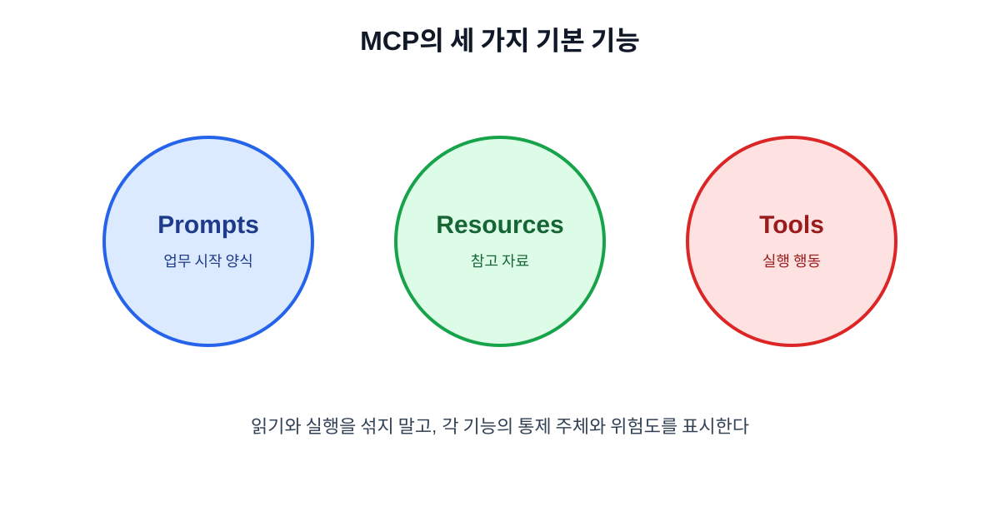

# 04. Tools·Resources·Prompts 이해하기

MCP 서버가 제공하는 기능은 크게 Tools, Resources, Prompts로 나눠 생각할 수 있습니다. 셋을 섞어 부르면 “읽기만 해야 할 기능이 실행 버튼으로 노출되는” 문제가 생깁니다.

## 4.1 Tools: 행동을 요청하는 기능

Tool은 검색, 계산, 파일 작성, 일정 생성처럼 입력을 받아 어떤 일을 수행하는 기능입니다. 특히 외부 상태를 바꾸는 Tool은 읽기 도구와 분리하고, 입력·권한·실패 결과를 명확히 해야 합니다.

| Tool 예 | 상태 변경 | 권장 기본값 |
| --- | --- | --- |
| 주문 상태 조회 | 없음 | 자동 허용 가능 |
| 정책 문서 검색 | 없음 | 자동 허용 가능 |
| 이메일 초안 저장 | 내부 상태 변경 | 사후 확인 |
| 이메일 발송 | 외부 상태 변경 | 발송 전 승인 |
| 결제·삭제 | 큰 상태 변경 | 이중 승인 또는 금지 |

## 4.2 Resources: 참고 자료를 제공하는 기능

Resource는 모델이 판단에 사용할 수 있는 문서나 구조화된 데이터입니다. Resource를 읽는다고 해서 반드시 도구를 실행한 것은 아니지만, 민감한 정보가 모델의 Context에 들어가는 순간 개인정보·접근권한 문제가 생깁니다.

Resource를 설계할 때는 다음을 표시합니다.

- 원본 위치와 소유자
- 마지막 갱신 시각
- 사용자가 볼 수 있는 범위
- 개인정보·기밀 정보 포함 여부
- 캐시 가능 여부와 만료 시간

## 4.3 Prompts: 반복 업무의 시작 양식

Prompt는 사용자가 매번 긴 지시를 입력하지 않아도 정해진 업무를 시작할 수 있게 하는 양식입니다. 예를 들어 “회의록을 결정·할 일·미결 질문으로 나누기”가 Prompt가 될 수 있습니다.

Prompt는 모델의 행동을 강제로 보장하지 않습니다. Prompt가 특정 Tool을 사용하도록 안내하더라도, Client의 권한 정책과 사용자 승인이 최종 경계입니다.

## 4.4 세 기능 비교

| 구분 | 주된 통제 주체 | 질문 | 예 |
| --- | --- | --- | --- |
| Prompt | 사용자 | 어떤 업무를 시작할까? | 회의록 정리 |
| Resource | 애플리케이션 | 어떤 자료를 참고할까? | 회의 문서 |
| Tool | 모델이 선택하되 정책 적용 | 어떤 행동을 실행할까? | 티켓 생성 |

## 4.5 기능을 쪼개는 예

“고객 정보를 관리한다”라는 Tool 하나에 조회·수정·삭제를 모두 넣지 않습니다.

| 나쁜 설계 | 나은 설계 |
| --- | --- |
| `manage_customer` | `find_customer`, `create_draft`, `update_address`, `delete_customer` |
| 인자에 임의 SQL 허용 | 필요한 필드만 구조화된 입력으로 받기 |
| 성공 여부만 반환 | 변경 전후, 권한, 오류 코드를 반환 |
| 모든 사용자가 실행 가능 | 읽기·초안·변경별 권한 분리 |

작은 기능은 모델이 선택하기 쉽고, 사람도 승인 화면에서 무엇이 바뀌는지 알기 쉽습니다.

## 4.6 기능 설명을 읽는 법

서버를 연결하기 전에 각 기능 설명에서 다음을 찾습니다.

| 확인 질문 | 안전한 설명의 예 |
| --- | --- |
| 무엇을 하는가? | 본인 주문의 배송 상태만 조회한다 |
| 무엇을 받는가? | 주문번호와 사용자 ID |
| 무엇을 바꾸는가? | 아무것도 바꾸지 않음 |
| 누가 쓸 수 있는가? | 로그인한 주문자 |
| 실패하면? | 주문 없음·권한 없음·일시 오류를 구분 |

## 장 요약

- Tools는 행동, Resources는 자료, Prompts는 반복 업무의 시작점이다.
- 읽기와 변경 기능을 하나의 만능 Tool로 합치지 않는다.
- 기능 설명에는 입력·권한·부작용·실패 방식을 함께 적는다.

## 출처

- [MCP 서버의 Tools·Resources·Prompts](https://modelcontextprotocol.io/specification/draft/server/index)

