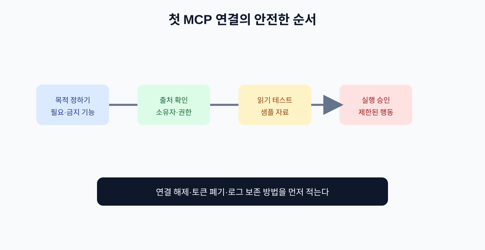

# 05. 첫 번째 MCP 서버 연결하기

이 장에서는 특정 제품 화면을 외우기보다, 어떤 MCP 클라이언트에서도 적용할 수 있는 연결 절차를 익힙니다. 제품마다 메뉴 이름은 다를 수 있지만, 확인해야 할 정보는 거의 같습니다.

## 5.1 연결 전에 준비할 것

| 준비 항목 | 예시 |
| --- | --- |
| 목적 | 사내 정책 문서를 검색하고 요약하기 |
| 필요한 기능 | 문서 목록 조회·본문 검색·읽기 |
| 금지 기능 | 문서 삭제·외부 공유 |
| 계정 | 업무용 최소 권한 계정 |
| 테스트 자료 | 민감 정보가 없는 샘플 문서 |
| 중단 방법 | 연결 해제와 토큰 폐기 절차 |

“유명한 MCP 서버니까 연결한다”가 아니라, 먼저 필요한 기능과 금지 기능을 적습니다.

## 5.2 서버 출처 확인

공식 저장소, 공식 레지스트리, 제공자 문서 중 최소 두 곳을 확인합니다. 이름이 비슷한 서버나 복제된 서버가 있을 수 있으므로, 다운로드 수만 보고 신뢰하지 않습니다.

| 확인 | 질문 |
| --- | --- |
| 소유자 | 누가 유지·배포하는가? |
| 코드 | 소스와 변경 이력이 공개되어 있는가? |
| 권한 | 어떤 토큰과 범위를 요구하는가? |
| 네트워크 | 어디로 데이터를 보내는가? |
| 업데이트 | 마지막 보안 수정 시점은 언제인가? |
| 삭제 | 연결을 끊고 토큰을 폐기할 수 있는가? |

## 5.3 연결 단계

1. 클라이언트의 MCP 설정 화면을 엽니다.
2. 공식 문서에서 안내한 서버 주소 또는 로컬 실행 명령을 확인합니다.
3. 필요한 인증 정보는 환경 변수나 비밀 저장소에 입력합니다.
4. 연결 후 노출되는 Tools·Resources·Prompts 목록을 검토합니다.
5. 읽기 전용 샘플 요청을 한 번 실행합니다.
6. 입력·결과·권한·로그가 예상과 같은지 확인합니다.
7. 실행 도구는 별도 승인 후 제한된 샘플로 시험합니다.

## 5.4 첫 테스트 질문

처음부터 “모든 업무를 처리해 줘”라고 하지 않습니다.

> 공개 샘플 문서에서 ‘환불 정책’이라는 단어가 포함된 문서 제목만 찾아 주세요. 문서를 수정하거나 외부로 보내지 마세요.

이 질문은 서버가 어떤 자료를 읽는지 확인하면서도 상태 변경을 유발하지 않습니다.

## 5.5 연결 결과 기록

| 기록할 값 | 이유 |
| --- | --- |
| 서버 이름·버전 | 나중에 같은 서버인지 확인 |
| 클라이언트와 사양 버전 | 호환성 문제 추적 |
| 노출된 기능 목록 | 예상 밖 기능 발견 |
| 사용한 계정·권한 범위 | 과도한 권한 확인 |
| 테스트 입력·결과 | 재현과 비교 |
| 연결 시각·승인자 | 감사와 책임 추적 |

## 5.6 연결을 중단해야 하는 신호

- 서버가 목적과 관계없는 파일이나 계정 권한을 요구한다.
- Tool 설명과 실제 행동이 다르다.
- 결과에 비밀키나 다른 사용자의 정보가 섞인다.
- 승인 없이 외부 상태를 변경한다.
- 서버 주소·배포자·소스가 확인되지 않는다.

이때는 추가 테스트보다 연결 해제, 토큰 폐기, 로그 보존을 먼저 합니다.

## 장 요약

- MCP 연결은 설치보다 사전 범위와 권한 확인이 먼저다.
- 읽기 전용 샘플로 시작하고 실행 도구는 별도 승인한다.
- 서버·클라이언트·사양·권한·테스트 결과를 기록한다.

## 출처

- [MCP 공식 레지스트리](https://registry.modelcontextprotocol.io/docs)
- [MCP 보안 관련 사양](https://modelcontextprotocol.io/specification)

