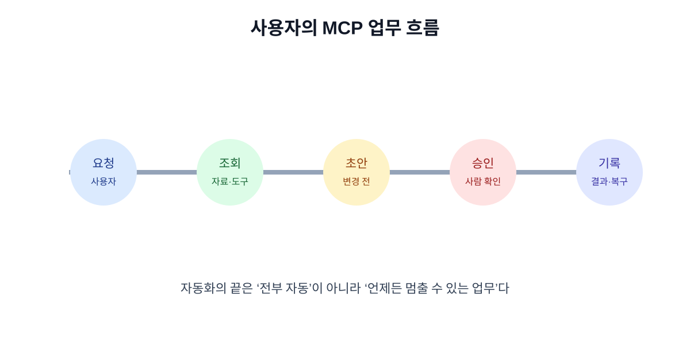

# 06. 실제 사용자가 MCP를 쓰는 하루

MCP의 가치는 설정 화면에 서버가 등록되어 있다는 사실이 아니라, 사용자가 업무를 더 적은 복사·붙여넣기로 처리하면서도 통제권을 유지하는 데 있습니다.

## 6.1 오전: 자료를 찾고 요약하기

기획자가 “이번 주 고객 피드백에서 배송 지연 사례를 세 가지 유형으로 정리해 줘”라고 요청했다고 합시다.

1. Host가 연결된 피드백 Resource와 검색 Tool을 확인합니다.
2. 모델이 기간과 키워드를 넣어 검색합니다.
3. Client가 사용자의 문서 접근 범위를 확인합니다.
4. 결과에 문서 제목·작성 시각·출처가 함께 표시됩니다.
5. 모델은 요약하지만 원문을 수정하지 않습니다.

사용자는 결과를 검토하고 “이 문서는 제외해”라고 수정할 수 있어야 합니다.

## 6.2 오후: 초안을 만들고 승인받기

운영자가 “반복되는 배송 지연에 대한 공지 초안을 만들어 줘”라고 요청합니다.

| 단계 | 자동화 가능 여부 | 사용자 확인 |
| --- | --- | --- |
| 관련 사례 찾기 | 가능 | 검색 범위가 맞는지 |
| 공지 초안 작성 | 가능 | 표현과 대상 |
| 내부 문서에 초안 저장 | 조직 정책에 따라 가능 | 저장 위치 |
| 고객에게 발송 | 자동 실행 금지에 가까움 | 수신자·내용·시점 |

MCP가 연결되어도 “초안 작성”과 “발송”은 다른 Tool이어야 합니다.

## 6.3 저녁: 문제가 생겼을 때

서버가 일시적으로 응답하지 않으면 사용자는 다음 세 가지를 알아야 합니다.

- 어떤 단계까지 성공했는가?
- 외부 시스템의 상태가 바뀌었는가?
- 다시 시도하면 중복 실행될 가능성이 있는가?

좋은 결과 화면은 “AI 오류”라고만 쓰지 않습니다. `검색은 완료됐지만 저장은 실패했습니다. 다시 저장하기 전 현재 문서 상태를 확인하세요.`처럼 성공 범위와 다음 행동을 보여 줍니다.

## 6.4 사용자가 보는 승인 화면

승인 화면에는 최소한 다음 정보가 있어야 합니다.

| 항목 | 예시 |
| --- | --- |
| 행동 | 공지 초안을 외부 채널에 게시 |
| 대상 | 고객지원 공지 채널 |
| 내용 | 실제 게시될 본문 전체 |
| 영향 | 2,300명에게 노출 |
| 되돌리기 | 게시 후 10분 내 비공개 가능 |
| 요청자 | 현재 로그인한 사용자 |

“허용할까요?”만 표시하고 실제 대상과 내용을 숨기면 승인이라고 부르기 어렵습니다.

## 6.5 사용자의 통제권 체크리스트

- 연결된 서버와 기능 목록을 볼 수 있는가?
- AI가 읽은 자료의 출처와 시각을 볼 수 있는가?
- 실행 전에 실제 변경 내용을 확인할 수 있는가?
- 작업을 취소하거나 연결을 끊을 수 있는가?
- 잘못된 결과를 신고하고 사람에게 넘길 수 있는가?
- 내 계정의 토큰을 폐기하거나 재발급할 수 있는가?

## 장 요약

- 실제 사용 흐름은 검색·요약·초안·승인·실행·기록으로 나뉜다.
- 사용자는 AI의 결과뿐 아니라 출처·대상·영향·복구 방법을 봐야 한다.
- 자동화의 좋은 기준은 사람이 중요한 예외에 집중하면서도 언제든 멈출 수 있는 것이다.

## 출처

- [MCP 공식 사양](https://modelcontextprotocol.io/specification)
- [MCP 보안 모범 사례](https://modelcontextprotocol.io/specification)

