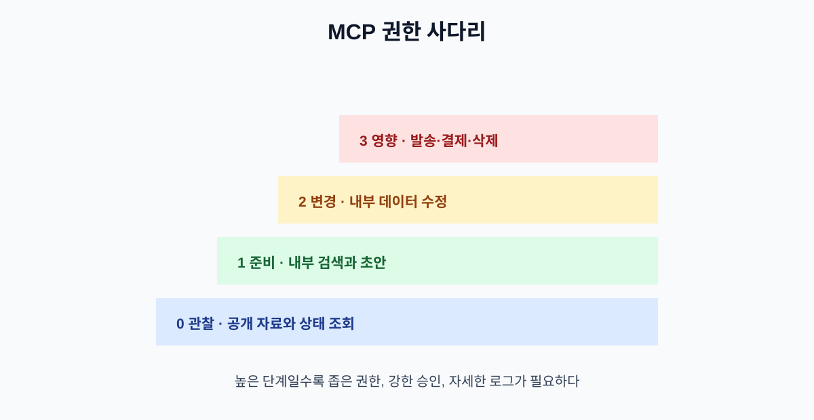

# 07. 읽기와 실행 권한 나누기

MCP를 연결하면 AI가 여러 기능을 발견할 수 있습니다. 그러나 발견할 수 있다는 것과 실행할 수 있다는 것은 다릅니다. 안전한 시스템은 자료 열람, 초안 작성, 외부 상태 변경을 서로 다른 권한 단계로 나눕니다.

## 7.1 네 단계 권한 모델

| 단계 | 할 수 있는 일 | 기본 승인 |
| --- | --- | --- |
| 0 관찰 | 공개 자료·상태 조회 | 자동 가능 |
| 1 준비 | 내부 검색·초안 생성 | 사후 확인 또는 제한 승인 |
| 2 변경 | 내부 데이터 수정·티켓 생성 | 실행 전 확인 |
| 3 영향 | 외부 발송·결제·삭제·권한 변경 | 사람 승인·이중 확인 |

위 단계는 제품의 버튼 이름이 아니라 업무 영향으로 나눕니다. 같은 “저장”이라도 개인 메모 저장과 고객에게 공개되는 게시물 저장은 위험도가 다릅니다.

## 7.2 읽기와 쓰기를 별도 Tool로 만들기

`manage_customer`처럼 조회·수정·삭제를 한 번에 수행하는 Tool은 모델이 어떤 행동을 선택했는지 사람이 확인하기 어렵습니다.

| 하나로 합친 설계 | 나눈 설계 |
| --- | --- |
| 고객 관리 | 고객 조회 |
|  | 주소 변경 초안 |
|  | 주소 변경 실행 |
|  | 고객 삭제 |

나눈 설계에서는 각 기능에 다른 권한과 승인 규칙을 붙일 수 있습니다. 또한 로그에서 “조회 후 주소 변경을 요청했다”는 흐름을 재구성할 수 있습니다.

## 7.3 최소 권한 체크리스트

- 이 Tool은 정말 필요한 데이터만 볼 수 있는가?
- 사용자의 계정 권한보다 넓은 권한을 서버가 갖고 있지 않은가?
- 읽기 토큰과 쓰기 토큰을 분리했는가?
- 개발·테스트·운영 환경의 서버와 토큰을 분리했는가?
- 사용하지 않는 Tool을 숨기거나 비활성화할 수 있는가?
- 토큰 만료·폐기·재발급 절차가 있는가?

## 7.4 승인 화면에 보여 줄 정보

승인을 요청할 때 “실행할까요?” 한 문장만 보여 주면 안 됩니다.

| 표시 항목 | 예시 |
| --- | --- |
| 행동 | 고객 주소 변경 요청 |
| 대상 | 주문번호 8814 |
| 변경 전 | 서울시 A구 |
| 변경 후 | 서울시 B구 |
| 요청 이유 | 사용자가 채팅에서 변경 요청 |
| 영향 | 다음 배송지에 적용 |
| 되돌리기 | 30분 안에 원래 주소로 복구 |

사용자가 무엇을 승인하는지 이해할 수 없으면 승인 절차가 있어도 실질적인 통제가 되지 않습니다.

## 7.5 권한 오류를 다루는 방법

권한 오류를 빈 결과로 바꾸지 않습니다. “검색 결과 없음”과 “볼 권한 없음”은 사용자의 다음 행동이 다릅니다.

| 오류 | 사용자 안내 | 시스템 처리 |
| --- | --- | --- |
| 로그인 만료 | 다시 로그인해 주세요 | 새 인증 시작 |
| 권한 부족 | 관리자에게 접근을 요청하세요 | 반복 호출 금지 |
| 자료 없음 | 조건을 바꿔 다시 검색하세요 | 검색어 수정 제안 |
| 정책상 거부 | 이 작업은 승인 후 가능합니다 | 승인 큐로 전달 |

## 7.6 비개발자용 권한 설계표

새 MCP 서버를 연결하기 전에 아래 표를 작성합니다.

| 기능 | 읽는 데이터 | 바꾸는 상태 | 위험도 | 승인자 |
| --- | --- | --- | --- | --- |
| 정책 검색 | 공개 정책 | 없음 | 낮음 | 없음 |
| 티켓 초안 | 고객 문의 | 내부 초안 | 중간 | 담당자 사후 확인 |
| 티켓 발송 | 고객 연락처·본문 | 외부 메시지 | 높음 | 팀 리더 |
| 환불 처리 | 주문·결제 정보 | 금액 상태 | 매우 높음 | 결제 담당자 2인 |

## 장 요약

- Tool의 발견·선택·실행 권한은 분리해야 한다.
- 읽기·초안·변경·고위험 실행을 서로 다른 단계로 관리한다.
- 승인 화면에는 대상, 변경 전후, 영향, 복구 방법을 표시한다.

## 출처

- [MCP 공식 사양](https://modelcontextprotocol.io/specification)
- [MCP 서버 기능과 도구](https://modelcontextprotocol.io/specification/draft/server/index)

