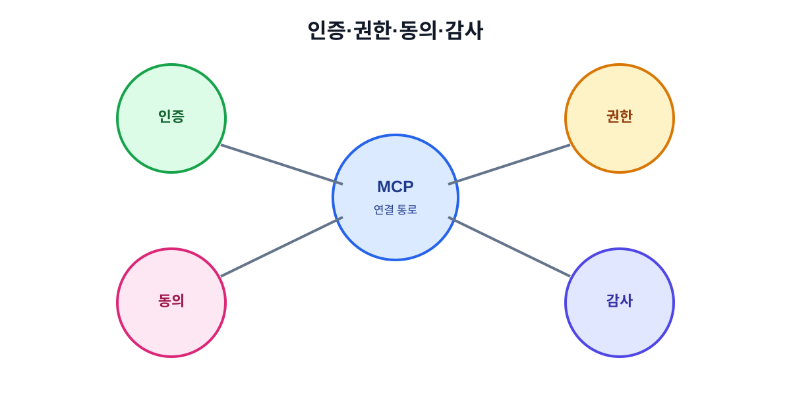

# 08. 인증·비밀키·사용자 동의

MCP 연결에서 가장 자주 발생하는 실수는 편리함을 위해 인증 정보를 대화창이나 설정 파일에 그대로 넣는 것입니다. 인증은 “누구인지 확인”하는 절차이고, 권한은 “무엇을 할 수 있는지 제한”하는 절차입니다. 둘을 같은 것으로 생각하지 않아야 합니다.



## 8.1 네 가지 보안 질문

| 질문 | 확인 대상 |
| --- | --- |
| 누가 접속했는가? | 사용자·서비스 계정 인증 |
| 무엇을 볼 수 있는가? | Resource 접근 범위 |
| 무엇을 실행할 수 있는가? | Tool 권한·승인 |
| 나중에 추적할 수 있는가? | 로그·감사 기록 |

로그인이 성공했다고 모든 Tool을 실행할 수 있는 것은 아닙니다.

## 8.2 비밀키를 다루는 원칙

- 키는 환경 변수나 전용 비밀 저장소에만 보관합니다.
- Git 저장소, 위키, 스크린샷, 분석 이벤트에 키를 넣지 않습니다.
- 개발·스테이징·운영 키를 분리합니다.
- 사용하지 않는 키는 즉시 폐기합니다.
- 키가 노출되었다고 의심되면 원인 조사보다 폐기와 교체를 먼저 합니다.

### 잘못된 예

```text
AI에게 다음 키를 사용해 줘: sk_live_여기에_비밀값
```

### 안전한 예

```text
MCP_SERVER_TOKEN은 서버의 비밀 저장소에서 읽고, 로그에는 마지막 네 글자만 남긴다.
```

## 8.3 사용자 동의는 한 번으로 끝나지 않는다

서버를 처음 연결할 때 동의했다고 해서 이후 모든 행동에 동의한 것은 아닙니다. 동의 범위를 다음처럼 나눕니다.

| 동의 시점 | 사용자가 확인할 것 |
| --- | --- |
| 서버 연결 | 제공자·주소·요구 권한 |
| 자료 열람 | 자료 범위·민감도·목적 |
| Tool 실행 | 대상·입력·변경 내용 |
| 외부 전송 | 수신자·내용·전송 시각 |
| 장시간 작업 | 예상 기간·중단 방법·비용 |

## 8.4 원격 MCP의 인증

원격 서버는 네트워크를 통해 요청을 받기 때문에 서버 주소, TLS, 인증 방식, 토큰 발급 주체를 확인합니다. 공개된 URL이라고 안전한 것은 아닙니다.

| 확인 항목 | 위험 신호 |
| --- | --- |
| 주소 | 철자가 비슷한 비공식 도메인 |
| 암호화 | HTTPS가 아니거나 인증서 오류 |
| 발급자 | 토큰을 누가 발급했는지 불명확 |
| 범위 | 문서 읽기에 계정 전체 권한 요구 |
| 갱신 | 만료·폐기 방법이 없음 |

## 8.5 로컬 MCP의 인증

로컬 서버는 인터넷으로 나가지 않아도 컴퓨터 안의 파일과 프로세스에 접근할 수 있습니다. 따라서 “로컬이므로 안전하다”는 결론을 내리면 안 됩니다.

- 실행 파일의 출처와 변경 이력을 확인합니다.
- 접근할 폴더를 별도 샘플 디렉터리로 제한합니다.
- 운영 계정이 아닌 제한된 OS 계정으로 실행합니다.
- 네트워크 접근이 필요 없는 서버는 네트워크 권한을 막습니다.
- 로컬 로그에도 개인정보와 토큰이 남지 않게 합니다.

## 8.6 사고 대응 순서

1. 의심되는 서버와 토큰을 즉시 비활성화합니다.
2. 어떤 사용자·Tool·시간대가 영향을 받았는지 로그를 보존합니다.
3. 비밀키를 교체하고 접근 범위를 줄입니다.
4. 외부 시스템의 변경 내역과 데이터 유출 여부를 확인합니다.
5. 재연 테스트 후 연결을 단계적으로 복구합니다.

## 장 요약

- 인증, 권한, 사용자 동의, 감사는 서로 다른 층이다.
- 비밀키는 대화·소스·로그에 남기지 않는다.
- 로컬 서버도 파일·프로세스·네트워크 권한을 별도로 제한한다.

## 출처

- [MCP 공식 보안 및 권한 문서](https://modelcontextprotocol.io/specification)
- [Agentic AI Foundation](https://aaif.io/)

