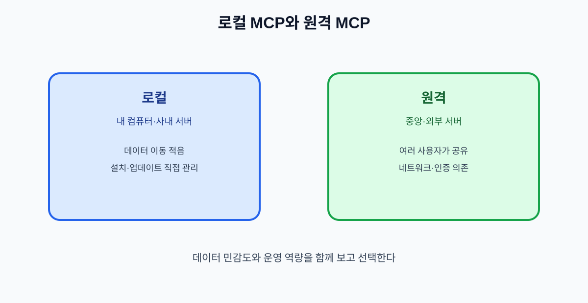

# 09. 로컬 MCP와 원격 MCP

MCP 서버는 내 컴퓨터에서 실행할 수도 있고 인터넷의 원격 서비스로 연결할 수도 있습니다. 어느 쪽이 무조건 더 안전한 것은 아닙니다. 데이터의 민감도, 운영 방식, 업데이트 빈도, 장애 대응 역량을 함께 비교해야 합니다.

## 9.1 차이 한눈에 보기

| 구분 | 로컬 MCP | 원격 MCP |
| --- | --- | --- |
| 실행 위치 | 사용자 컴퓨터·사내 서버 | 외부 또는 중앙 서버 |
| 설치 | 프로그램·런타임 필요 | 주소·인증으로 연결 |
| 데이터 이동 | 외부 전송을 줄일 수 있음 | 네트워크 전송 발생 |
| 업데이트 | 사용자가 직접 관리 | 제공자가 배포 |
| 장애 | 개인 환경 영향 | 여러 사용자가 공유 |
| 감사 | 컴퓨터별 로그 | 중앙 로그 구성 가능 |
| 위험 | 로컬 파일·프로세스 접근 | 원격 인증·공급자 신뢰 |

## 9.2 로컬이 적합한 상황

- 외부로 보내면 안 되는 문서를 로컬 폴더에서 검색할 때
- 개발·실험 단계에서 샘플 데이터로 기능을 검증할 때
- 네트워크가 제한된 환경에서 동작해야 할 때

단, 로컬 서버가 사용자의 전체 홈 디렉터리를 읽도록 설정하면 데이터 최소화 원칙을 위반할 수 있습니다.

## 9.3 원격이 적합한 상황

- 여러 팀이 같은 업무 시스템을 사용해야 할 때
- 중앙에서 버전·권한·로그를 관리해야 할 때
- 서버를 항상 켜 두고 장시간 작업을 처리해야 할 때

원격 서버는 네트워크와 인증에 의존하므로 장애 시 읽기 전용 폴백이나 수동 처리 경로를 준비합니다.

## 9.4 선택표

| 질문 | 로컬 쪽으로 기움 | 원격 쪽으로 기움 |
| --- | --- | --- |
| 데이터가 외부로 나가도 되는가? | 아니오 | 예 |
| 여러 사용자가 공유해야 하는가? | 아니오 | 예 |
| 중앙 감사가 필요한가? | 낮음 | 높음 |
| 설치·업데이트를 직접 관리할 수 있는가? | 예 | 아니오 |
| 시스템이 계속 실행되어야 하는가? | 아니오 | 예 |

## 9.5 두 방식을 함께 쓰는 패턴

민감한 원문은 로컬 Resource로 읽고, 비식별화한 요약만 원격 판단 서버에 보내는 식으로 경계를 나눌 수 있습니다. 이 경우에도 요약문에서 개인을 다시 알아볼 수 있는지 확인해야 합니다.

| 단계 | 위치 | 예시 |
| --- | --- | --- |
| 원문 수집 | 로컬 | 고객 문의 파일 |
| 최소화·마스킹 | 로컬 | 이름·전화번호 제거 |
| 분류 판단 | 원격 | 문의 유형 선택 |
| 실행 | 사내 시스템 | 담당 큐 등록 |

## 장 요약

- 로컬은 데이터 통제에 유리하지만 설치 환경과 로컬 권한을 관리해야 한다.
- 원격은 중앙 운영에 유리하지만 인증·네트워크·공급자 신뢰를 검증해야 한다.
- 민감한 원문과 원격 판단을 분리하는 혼합 구조도 가능하다.

## 출처

- [MCP 공식 사양](https://modelcontextprotocol.io/specification)
- [MCP 공식 레지스트리](https://registry.modelcontextprotocol.io/docs)

