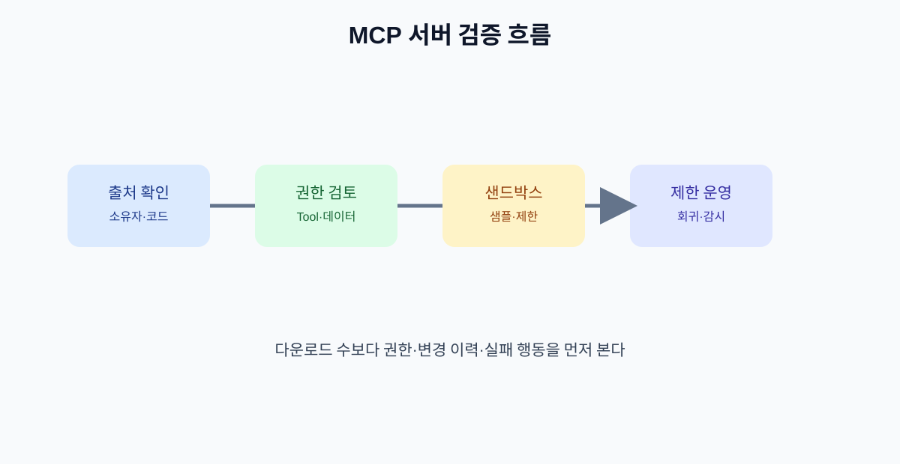

# 11. MCP 서버를 고르고 검증하는 방법

MCP 서버는 AI의 능력을 늘려 주지만, 연결한 서버의 품질과 의도를 그대로 상속받기도 합니다. 서버를 선택하는 일은 앱을 설치하는 일보다 공급망을 검토하는 일에 가깝습니다.

## 11.1 공식 출처부터 확인하기

가능하면 제공자 공식 문서, 공식 저장소, 공식 레지스트리에서 같은 정보를 교차 확인합니다. 검색 결과의 첫 번째 링크나 별점만으로 서버를 선택하지 않습니다.

| 확인 순서 | 볼 것 |
| --- | --- |
| 소유자 | 조직·개인·연락 수단 |
| 저장소 | 소스·이슈·릴리스 이력 |
| 배포물 | 패키지 이름과 서명·해시 |
| 권한 | 파일·네트워크·계정 접근 범위 |
| 운영 | 보안 신고·업데이트·지원 정책 |

## 11.2 기능 목록을 읽는 법

서버를 연결하면 우선 Tools·Resources·Prompts 목록을 표로 옮겨 적습니다.

| 기능 | 읽기/쓰기 | 입력 | 외부 영향 | 승인 |
| --- | --- | --- | --- | --- |
| `search_policy` | 읽기 | 검색어 | 없음 | 없음 |
| `create_draft` | 쓰기 | 제목·본문 | 내부 초안 | 사후 확인 |
| `send_message` | 쓰기 | 수신자·본문 | 외부 발송 | 실행 전 |

설명되지 않은 기능, 목적에 비해 지나치게 넓은 입력, 임의 URL·명령을 받는 Tool은 연결을 보류합니다.

## 11.3 샌드박스에서 시험하기

처음부터 실제 고객·운영 데이터에 연결하지 않습니다.

1. 가짜 계정과 샘플 문서를 준비합니다.
2. 네트워크·파일 접근 범위를 최소화합니다.
3. 읽기 전용 기능을 먼저 실행합니다.
4. 실패·권한 오류·빈 결과를 확인합니다.
5. 예상하지 않은 네트워크 요청과 파일 변경을 확인합니다.
6. 결과가 합의된 뒤 제한된 운영 데이터로 확대합니다.

## 11.4 변경 이력과 업데이트

서버가 업데이트되면 도구 설명, 권한, 결과 형식이 바뀔 수 있습니다. 자동 업데이트만 켜 두지 말고 변경을 평가할 기준을 정합니다.

| 변경 | 재검토 수준 |
| --- | --- |
| 문서·버그 수정 | 샘플 회귀 테스트 |
| Tool 입력·출력 변경 | 통합 테스트와 사용자 승인 |
| 권한·인증 변경 | 보안 검토 후 재연결 |
| 새 실행 Tool 추가 | 별도 승인과 제한 출시 |

## 장 요약

- 서버 선택은 공급망·권한·운영 정책을 함께 검토하는 일이다.
- 기능 목록을 읽기·쓰기·외부 영향 기준으로 표준화한다.
- 샌드박스, 회귀 테스트, 변경 이력 검토를 거쳐 운영에 연결한다.

## 출처

- [MCP 공식 레지스트리](https://registry.modelcontextprotocol.io/docs)
- [MCP 공식 블로그](https://blog.modelcontextprotocol.io/)

