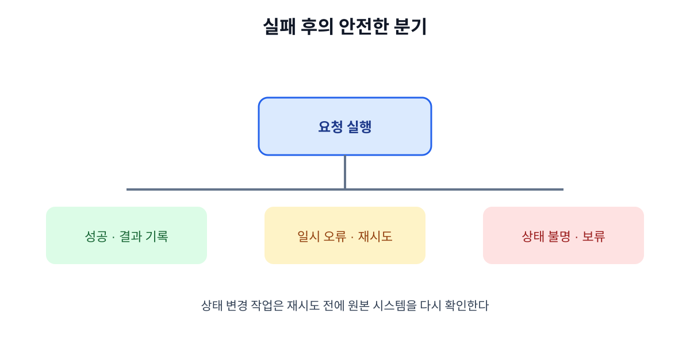

# 12. 실패·재시도·중단·복구

MCP를 실제 업무에 연결하면 네트워크 지연, 인증 만료, 외부 API 제한, 중복 실행 같은 실패가 발생합니다. 실패를 숨기고 “다시 해 보세요”라고만 말하면 사용자는 같은 행동을 반복해 피해를 키울 수 있습니다.

## 12.1 실패를 네 종류로 나누기

| 종류 | 예 | 재시도 |
| --- | --- | --- |
| 입력 오류 | 필수 값 누락·형식 오류 | 수정 후 한 번 |
| 권한 오류 | 토큰 만료·접근 거부 | 인증·권한 수정 후 |
| 일시 장애 | 네트워크·서버 과부하 | 지수 백오프 |
| 상태 불명 | 요청 후 응답 끊김 | 중복 방지 확인 후 |

## 12.2 재시도해도 되는 경우

일시적인 502·503·504나 네트워크 타임아웃은 짧은 간격을 두고 재시도할 수 있습니다. 하지만 결제·발송·삭제처럼 상태를 바꾸는 작업은 “응답이 없었다”는 이유만으로 즉시 재시도하면 중복 실행이 될 수 있습니다.

## 12.3 멱등성과 중복 실행

같은 요청을 두 번 보내도 결과가 한 번만 적용되도록 요청 식별자와 서버 측 중복 검사를 둡니다.

| 상황 | 안전한 처리 |
| --- | --- |
| 조회 재시도 | 같은 조회를 다시 실행 |
| 초안 저장 재시도 | 문서 ID로 기존 초안 확인 |
| 메시지 발송 응답 없음 | 발송 기록 조회 후 결정 |
| 결제 응답 없음 | 결제 상태를 원본 시스템에서 확인 |

## 12.4 중단 버튼의 의미

사용자가 중단을 눌렀을 때 이미 시작된 외부 작업까지 자동으로 되돌아가는 것은 아닙니다. 화면에 다음을 구분해서 표시합니다.

- 아직 실행되지 않아 취소된 단계
- 실행 중이며 취소 요청을 보낸 단계
- 이미 완료되어 별도 복구가 필요한 단계

## 12.5 복구 기록

장애가 끝난 뒤 원인을 찾으려면 다음을 연결해 기록해야 합니다.

| 기록 | 예 |
| --- | --- |
| 작업 ID | `job_20261019_0142` |
| 사용자·승인자 | 운영팀 홍길동 |
| 서버·버전 | policy-mcp 2.4 |
| Tool·입력 요약 | `create_draft`, 문서 8814 |
| 시도 횟수 | 1회 실패 후 보류 |
| 외부 상태 | 문서 변경 없음 |
| 다음 담당자 | 고객지원 2팀 |

## 장 요약

- 실패는 입력·권한·일시 장애·상태 불명으로 나눠야 한다.
- 상태 변경 작업은 중복 실행 방지와 원본 상태 확인이 우선이다.
- 중단과 복구는 화면·로그·담당자 전달까지 한 세트로 설계한다.

## 출처

- [MCP 공식 사양](https://modelcontextprotocol.io/specification)

