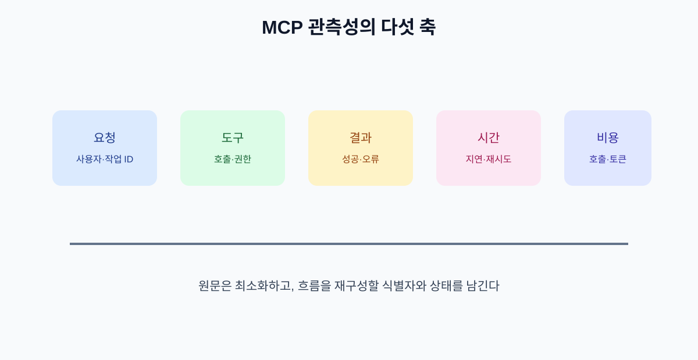

# 13. 로그·관측성·비용 관리

MCP가 업무에 들어가면 “잘 작동하는가?”만으로 부족합니다. 어떤 서버가 어떤 자료를 읽고 어떤 Tool을 몇 번 호출했는지, 지연과 비용이 어느 정도인지 확인할 수 있어야 합니다.

## 13.1 최소 로그 항목

로그에는 원문 전체보다 추적에 필요한 요약과 식별자를 남깁니다.

| 항목 | 기록 예 |
| --- | --- |
| 요청 ID | 한 업무 흐름을 묶는 ID |
| 사용자·조직 | 권한 추적용 식별자 |
| Host·Client·Server | 제품·버전·서버명 |
| Tool | 호출한 기능 이름 |
| 입력 요약 | 민감정보를 제거한 필드 |
| 결과 상태 | 성공·거부·시간 초과 |
| 지연 | Client·Server·원본 API별 시간 |
| 비용 | 호출 수·토큰·외부 과금 |

## 13.2 로그에 남기면 안 되는 것

- API 키·비밀번호·세션 토큰
- 주민번호·전체 카드번호 같은 불필요한 민감정보
- 고객 문서 원문 전체
- 승인 없이 다른 사용자의 데이터

필요한 경우 원문은 별도 접근 통제 저장소에 보관하고 로그에는 참조 ID만 남깁니다.

## 13.3 운영 대시보드 지표

| 지표 | 의미 | 경보 예 |
| --- | --- | --- |
| 성공률 | 요청이 정상 결과를 반환한 비율 | 5분간 95% 미만 |
| 승인 거부율 | 사용자가 실행을 거부한 비율 | 평소 대비 급증 |
| Tool별 오류 | 특정 기능의 고장 | 같은 오류 반복 |
| 지연시간 | 사용자가 기다린 시간 | p95 기준 초과 |
| 재시도율 | 일시 장애와 중복 시도 | 급격한 상승 |
| 비용 | 호출·토큰·외부 API 비용 | 일일 한도 초과 |

## 13.4 비용을 줄이는 방법

1. 같은 자료를 매번 전체 전달하지 말고 필요한 범위만 제공합니다.
2. 읽기와 실행을 별도 Tool로 나누어 불필요한 호출을 줄입니다.
3. 캐시 가능한 Resource와 최신 조회가 필요한 Resource를 구분합니다.
4. 장시간 작업에 최대 시간·호출 횟수·비용 상한을 둡니다.
5. 테스트는 샘플 데이터와 제한된 계정으로 실행합니다.

## 장 요약

- 관측성은 성공률뿐 아니라 권한·도구·지연·비용을 연결해 보는 것이다.
- 로그에는 추적 정보는 남기고 비밀값과 불필요한 원문은 남기지 않는다.
- 비용 상한과 호출 횟수 제한은 기능 설계 단계부터 넣는다.

## 출처

- [MCP 공식 로드맵](https://blog.modelcontextprotocol.io/posts/mcp-roadmap/)
- [MCP 공식 사양](https://modelcontextprotocol.io/specification)

