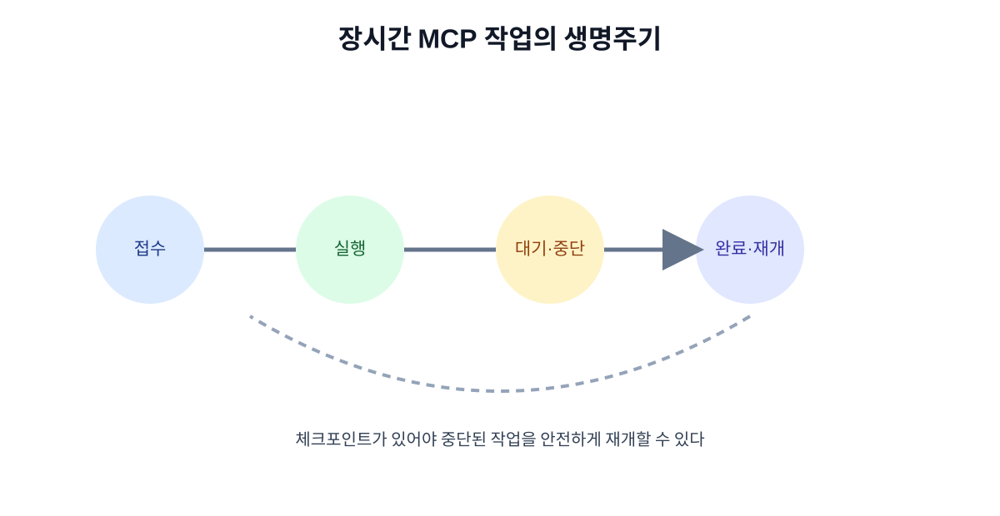

# 14. 장시간 작업과 Tasks

짧은 검색은 요청과 응답이 한 번에 끝나지만, 대량 문서 분석·보고서 생성·데이터 정리처럼 오래 걸리는 일은 사용자가 화면을 계속 열어 둘 수 없습니다. 이런 작업은 진행 상태, 중단, 재개, 결과 확인을 별도의 흐름으로 설계해야 합니다.

## 14.1 작업 상태를 명확히 하기

| 상태 | 의미 | 사용자에게 보여 줄 것 |
| --- | --- | --- |
| 접수 | 요청을 받음 | 작업 ID·예상 범위 |
| 실행 중 | 도구가 처리 중 | 진행률·현재 단계 |
| 대기 | 사람 승인이나 외부 응답 대기 | 누가 무엇을 해야 하는지 |
| 중단 | 취소되었거나 오류로 멈춤 | 완료·미완료 범위 |
| 완료 | 결과와 기록이 준비됨 | 결과·출처·다음 행동 |

## 14.2 장시간 작업의 안전 상한

- 최대 실행 시간
- 최대 Tool 호출 횟수
- 최대 데이터 처리량
- 최대 비용
- 재시도 횟수
- 사람이 승인해야 하는 단계

상한을 넘으면 작업을 조용히 계속하지 말고 보류·중단·요약 상태로 바꿉니다.

## 14.3 재개 가능한 체크포인트

작업이 중단되어도 처음부터 다시 하지 않도록 완료한 단계와 입력 버전을 기록합니다.

| 체크포인트 | 기록 예 |
| --- | --- |
| 자료 수집 | 1~500번 문서 완료 |
| 분류 | 320번 문서에서 중단 |
| 승인 | 운영자 승인 대기 |
| 출력 | 보고서 초안 저장 완료 |

## 14.4 사용자가 봐야 하는 진행 화면

“AI가 처리 중”만 표시하면 사용자는 멈춘 것인지 기다리는 것인지 알 수 없습니다.

> 1,200개 중 840개 문서를 읽었습니다. 현재 ‘중복 사례 묶기’ 단계입니다. 예상 6분, 사용량 한도 70%입니다. [일시 중지] [취소]

## 14.5 재개 전 검증

오래 멈춘 작업을 그대로 재개하면 권한·원본 데이터·정책이 바뀌었을 수 있습니다. 재개 전에 다음을 확인합니다.

- 사용자의 로그인과 권한이 아직 유효한가?
- 원본 문서와 Tool 버전이 바뀌지 않았는가?
- 이미 외부로 발송된 결과가 없는가?
- 재개 시 중복 변경이 일어나지 않는가?
- 비용·시간 상한이 남아 있는가?

## 장 요약

- 장시간 작업은 요청 하나가 아니라 상태를 가진 업무다.
- 진행률·중단·재개·복구를 사용자 화면과 로그에 함께 표시한다.
- Tasks 같은 확장을 사용할 때도 시간·호출·비용·권한 상한을 둔다.

## 출처

- [2026-07-28 MCP 사양 변경](https://blog.modelcontextprotocol.io/posts/2026-07-28/)
- [MCP 로드맵](https://blog.modelcontextprotocol.io/posts/mcp-roadmap/)

