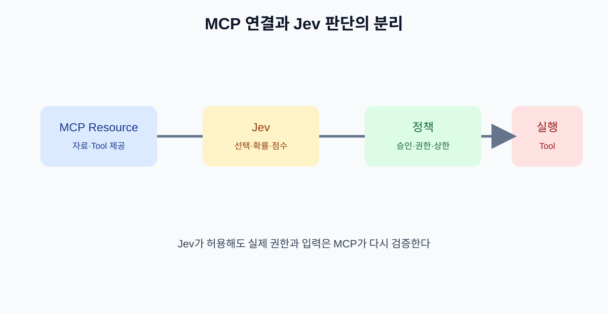

# 15. MCP와 Jev를 함께 쓰는 방법

MCP는 AI가 어떤 자료와 도구를 사용할 수 있게 하는 연결층이고, Jev는 주어진 상태를 보고 선택·점수·확률을 반환하는 판단층입니다. 둘을 합치면 “무엇을 연결할지”와 “그 연결을 언제 허용할지”를 분리해서 설계할 수 있습니다.

## 15.1 역할을 나누기

| 질문 | 담당 |
| --- | --- |
| 어떤 자료와 Tool을 제공할까? | MCP Server |
| 지금 사용자의 요청은 무엇인가? | 애플리케이션·Jev |
| 어떤 Tool을 선택할까? | 모델 + 정책 |
| 선택한 Tool을 실행해도 될까? | Jev·규칙·사람 승인 |
| 실제 상태를 바꾸는 주체는? | MCP Server와 원본 시스템 |

Jev의 “실행 가능” 판단을 권한 토큰처럼 사용하면 안 됩니다. 권한과 입력 검증은 MCP Client와 Server가 다시 수행해야 합니다.

## 15.2 고객지원 예시

1. MCP Resource가 고객 문의와 주문 상태를 제공합니다.
2. Jev가 문의 유형, 사람 검토 필요 여부, 긴급도를 판단합니다.
3. 정책이 `confidence >= 0.8`인 배송 조회만 자동 Tool을 허용합니다.
4. 주소 변경·환불은 사람 승인 큐로 보냅니다.
5. 결과와 승인자를 로그에 남깁니다.

| Jev 결과 | MCP 행동 |
| --- | --- |
| 배송 조회, 높은 확률 | 배송 상태 조회 Tool |
| 결제 문의 | 결제팀 티켓 초안 Tool |
| 사람 검토 필요 | 어떤 실행 Tool도 호출하지 않음 |
| 불확실 | 추가 질문 Resource 또는 사람 큐 |

## 15.3 상태를 한 번만 정의하지 않기

Jev에 보낸 state와 MCP Tool에 보낸 입력은 목적이 다릅니다. Jev에는 판단에 필요한 최소 사실을, 실행 Tool에는 권한 검증에 필요한 원본 식별자를 보냅니다.

| 데이터 | Jev 판단 | 실행 Tool |
| --- | --- | --- |
| 문의 요약 | 포함 가능 | 설명용 |
| 주문번호 | 포함 | 필수 원본 값 |
| 고객 전체 주소 | 불필요하면 제외 | 변경 시 서버에서 재조회 |
| 확률 | 정책 입력 | 로그·승인 근거 |

## 15.4 실패 경계

Jev가 성공해도 MCP Server가 실패할 수 있고, MCP 조회가 성공해도 Jev 판단이 불확실할 수 있습니다. 각 결과를 별도로 기록합니다.

| 단계 | 성공 | 실패 |
| --- | --- | --- |
| 자료 조회 | 최신 Resource 확보 | 재검색·사람 전달 |
| 판단 | 선택·확률 반환 | 기본값·보류 |
| 정책 | Tool 허용 | 승인 필요 |
| 실행 | 원본 상태 변경 | 중복 방지·복구 |

## 장 요약

- MCP는 연결, Jev는 판단, 애플리케이션은 정책과 실행을 맡는다.
- Jev 결과를 권한으로 직접 사용하지 않는다.
- 판단 입력과 실행 입력을 분리하고 각 단계의 실패를 기록한다.

## 출처

- [Jev 공식 문서](https://jev-ai.org/docs/)
- [MCP 공식 사양](https://modelcontextprotocol.io/specification)

