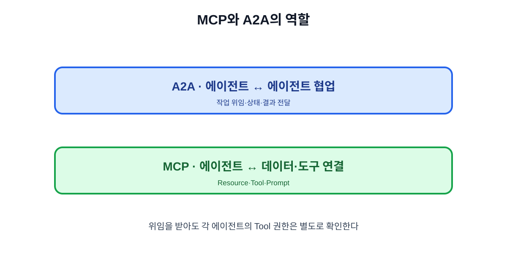

# 16. MCP와 A2A: 도구 연결과 에이전트 협업

MCP와 A2A는 경쟁하는 같은 기능이 아닙니다. MCP는 한 AI 애플리케이션이 도구·자료와 연결되는 방법을 다루고, A2A는 독립된 에이전트가 서로 작업을 요청하고 결과를 주고받는 방법을 다룹니다.

## 16.1 간단한 비교

| 구분 | MCP | A2A |
| --- | --- | --- |
| 연결 대상 | AI 앱 ↔ 자료·Tool | 에이전트 ↔ 에이전트 |
| 핵심 질문 | 어떤 기능을 사용할 수 있는가? | 누가 어떤 작업을 맡을 수 있는가? |
| 예시 | 캘린더 조회·문서 검색 | 영업 에이전트가 배송 에이전트에 조사 요청 |
| 위험 | 과도한 Tool 권한 | 잘못된 에이전트 위임·신뢰 |
| 필요한 통제 | 사용자 승인·Tool 정책 | 에이전트 신원·작업 범위·결과 검증 |

## 16.2 함께 쓰는 업무 흐름

1. 총괄 에이전트가 사용자의 요청을 받습니다.
2. A2A로 배송 전문 에이전트에 배송 상태 조사를 요청합니다.
3. 배송 에이전트는 MCP로 내부 주문 시스템에 접근합니다.
4. 결과를 A2A로 총괄 에이전트에 반환합니다.
5. 총괄 에이전트가 Jev나 정책으로 다음 행동을 판단합니다.
6. 외부 발송은 사람 승인 후 MCP Tool로 실행합니다.

## 16.3 위임할 때 확인할 것

| 확인 | 질문 |
| --- | --- |
| 신원 | 이 에이전트는 누가 운영하는가? |
| 능력 | 어떤 작업과 Tool을 사용할 수 있는가? |
| 범위 | 이번 요청에서 허용된 자료와 시간은? |
| 결과 | 출처·버전·확률·완료 상태가 있는가? |
| 책임 | 실패 시 어느 팀이 복구하는가? |

## 16.4 무조건 다중 에이전트로 만들지 않기

단순한 문서 검색 하나를 여러 에이전트에 나누면 지연·비용·실패 지점만 늘어납니다. 다음 조건이 있을 때만 위임을 고려합니다.

- 업무 영역별 권한과 전문성이 실제로 분리되어 있다.
- 각 에이전트의 입력·출력 계약을 정의할 수 있다.
- 결과를 검증할 수 있고, 실패 시 사람에게 넘길 수 있다.
- 한 에이전트에 모든 권한을 주는 것보다 위험이 줄어든다.

## 장 요약

- MCP는 도구·자료 연결, A2A는 에이전트 간 작업 위임을 다룬다.
- A2A로 위임한 에이전트도 MCP Tool 권한을 별도로 검증해야 한다.
- 다중 에이전트는 전문성·권한·복구 경계가 분명할 때만 사용한다.

## 출처

- [A2A 프로토콜 도입 현황](https://www.linuxfoundation.org/press/a2a-protocol-surpasses-150-organizations-lands-in-major-cloud-platforms-and-sees-enterprise-production-use-in-first-year)
- [MCP 공식 사양](https://modelcontextprotocol.io/specification)

