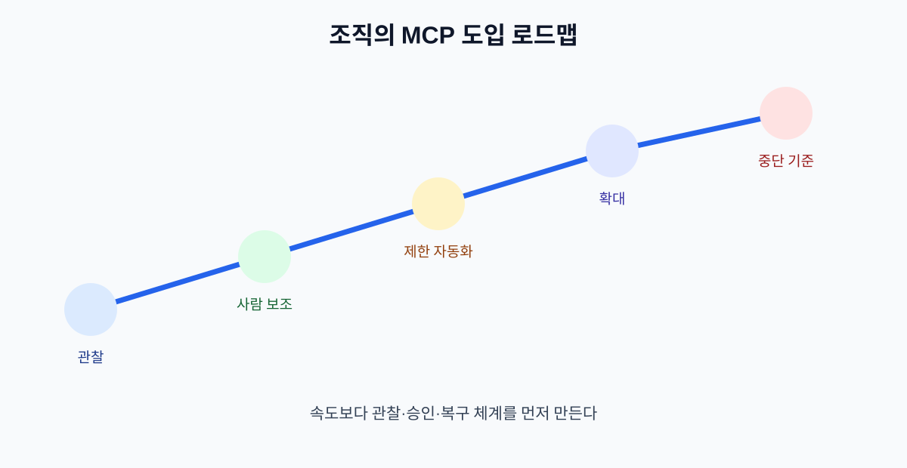

# 17. 조직에 MCP를 도입하는 순서

MCP 도입은 서버 하나를 연결하는 기술 프로젝트가 아니라 데이터·권한·업무 책임을 다시 정하는 변화입니다. 작은 내부 업무에서 시작해 관찰과 승인 체계를 만든 뒤 범위를 넓힙니다.

## 17.1 네 단계 도입

| 단계 | 목표 | 허용 범위 |
| --- | --- | --- |
| 관찰 | 어떤 업무가 반복되는지 확인 | 읽기 전용·결과 기록 |
| 사람 보조 | 담당자에게 추천 제공 | 초안·검색 |
| 제한 자동화 | 저위험 행동 실행 | 작은 팀·샘플 데이터 |
| 확대 | 여러 팀·시스템으로 확장 | 중앙 정책·감사·SLA |

## 17.2 선정 기준

첫 업무는 다음 조건에 가까울수록 좋습니다.

- 실패해도 외부 피해가 작다.
- 사람이 쉽게 결과를 확인하고 되돌릴 수 있다.
- 입력과 성공 기준이 비교적 명확하다.
- 반복량이 충분해 개선 효과를 측정할 수 있다.
- 민감한 개인정보와 고위험 변경이 적다.

예: 공개 정책 검색, 내부 회의 자료 정리, 문의 유형 추천.

피해야 할 첫 업무: 자동 환불, 인사 평가 결정, 계정 삭제, 법적 답변 발송.

## 17.3 역할과 책임

| 역할 | 책임 |
| --- | --- |
| 업무 담당자 | 목적·예외·성공 기준 정의 |
| 보안 담당자 | 권한·토큰·데이터 범위 검토 |
| 플랫폼 담당자 | 서버·클라이언트·로그 운영 |
| 승인자 | 외부 영향 행동 승인 |
| 운영자 | 오류·피드백·복구 처리 |

## 17.4 도입 전 합의 문서

한 페이지에 다음을 적습니다.

1. 연결할 데이터와 Tool
2. 허용·금지 행동
3. 사람 승인 지점
4. 로그와 보존 기간
5. 장애·토큰 노출 대응
6. 성공 지표와 중단 기준

## 17.5 중단 기준

다음 조건 중 하나라도 충족하면 자동화를 확대하지 않습니다.

- 낮은 확률 결과가 외부 행동으로 이어진다.
- 승인 화면에서 실제 변경 내용이 보이지 않는다.
- 원문·토큰이 로그에 남는다.
- 실패 후 중복 실행을 확인할 방법이 없다.
- 서버 업데이트 후 회귀 테스트가 없다.

## 장 요약

- 관찰과 사람 보조를 거친 뒤 제한 자동화로 확대한다.
- 첫 업무는 저위험·가역적·측정 가능한 업무로 선택한다.
- 업무·보안·플랫폼·승인·운영 책임을 문서로 나눈다.

## 출처

- [MCP 공식 로드맵](https://blog.modelcontextprotocol.io/posts/mcp-roadmap/)
- [Agentic AI Foundation](https://aaif.io/)

