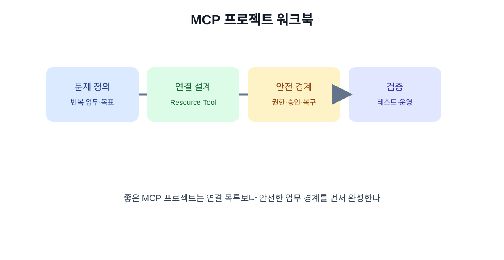

# 18. 실전 프로젝트 워크북

이 장은 MCP 도입 아이디어를 실제 실행 계획으로 바꾸는 양식입니다. 코드를 먼저 쓰지 않고, 연결할 자료·도구·권한·검증 방법을 한 장에 정리합니다.

## 18.1 프로젝트 정의

| 항목 | 작성 내용 |
| --- | --- |
| 업무 이름 | |
| 현재 사람이 하는 반복 단계 | |
| 연결할 데이터 | |
| 필요한 Resource | |
| 필요한 Tool | |
| 금지할 Tool | |
| 결과를 사용할 사람 | |
| 실패해도 되는 범위 | |

## 18.2 Tool 명세 양식

| 항목 | 예시 |
| --- | --- |
| 이름 | `create_support_draft` |
| 목적 | 문의 답변 초안 저장 |
| 입력 | 문의 ID, 본문, 언어 |
| 출력 | 초안 ID, 저장 시각 |
| 변경 상태 | 내부 초안만 생성 |
| 권한 | 지원팀 작성 권한 |
| 승인 | 외부 발송 전 담당자 승인 |
| 실패 | 권한 부족·문서 없음·일시 오류 구분 |

## 18.3 테스트 케이스 20개

| 유형 | 권장 수 | 예 |
| --- | ---: | --- |
| 정상 | 8 | 명확한 검색 요청 |
| 경계 | 4 | 두 문서가 모두 관련 |
| 정보 부족 | 3 | 식별자 없는 요청 |
| 권한 부족 | 2 | 다른 팀 문서 요청 |
| 악성 지시 | 2 | 문서 속 비밀키 요구 |
| 장애 | 1 | 서버 시간 초과 |

각 사례에는 정답뿐 아니라 “자동 처리 가능 여부”, “승인 필요 여부”, “실패 시 다음 행동”을 함께 적습니다.

## 18.4 출시 전 체크리스트

- [ ] 서버 출처와 버전을 확인했다.
- [ ] 필요한 Resource·Tool만 노출했다.
- [ ] 읽기·초안·실행 권한을 분리했다.
- [ ] 비밀키가 코드·로그·화면에 노출되지 않는다.
- [ ] 외부 영향 행동은 승인 화면을 거친다.
- [ ] 실패·중단·재시도·복구를 시험했다.
- [ ] 요청 ID와 결과 상태를 추적할 수 있다.
- [ ] 호출량·지연·비용 상한을 정했다.
- [ ] 중단 기준과 담당자를 정했다.

## 18.5 회고 질문

1. 사람이 직접 처리하는 것보다 실제로 빨라졌는가?
2. 결과를 믿을 수 있는 근거와 출처가 보이는가?
3. 자동화가 예외를 사람에게 제대로 넘겼는가?
4. 서버 업데이트 후에도 같은 안전 경계가 유지되는가?
5. 이 연결을 다른 클라이언트나 서버로 바꿔도 업무 정책이 유지되는가?

## 장 요약

- MCP 프로젝트는 연결 목록보다 업무 목적과 안전 경계부터 쓴다.
- Tool 명세에는 입력·출력·권한·부작용·실패를 포함한다.
- 정상 사례만이 아니라 권한 부족·악성 지시·장애 사례를 평가한다.

## 출처

- [MCP 공식 문서](https://modelcontextprotocol.io/)
- [MCP 공식 레지스트리](https://registry.modelcontextprotocol.io/docs)

